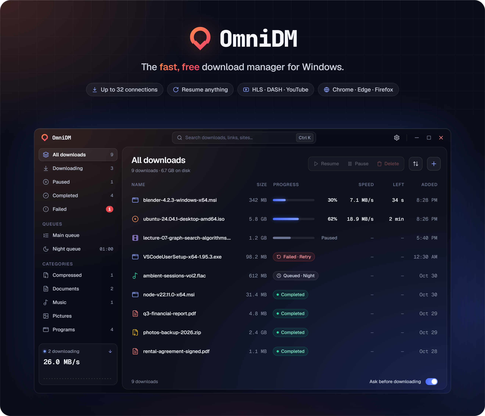
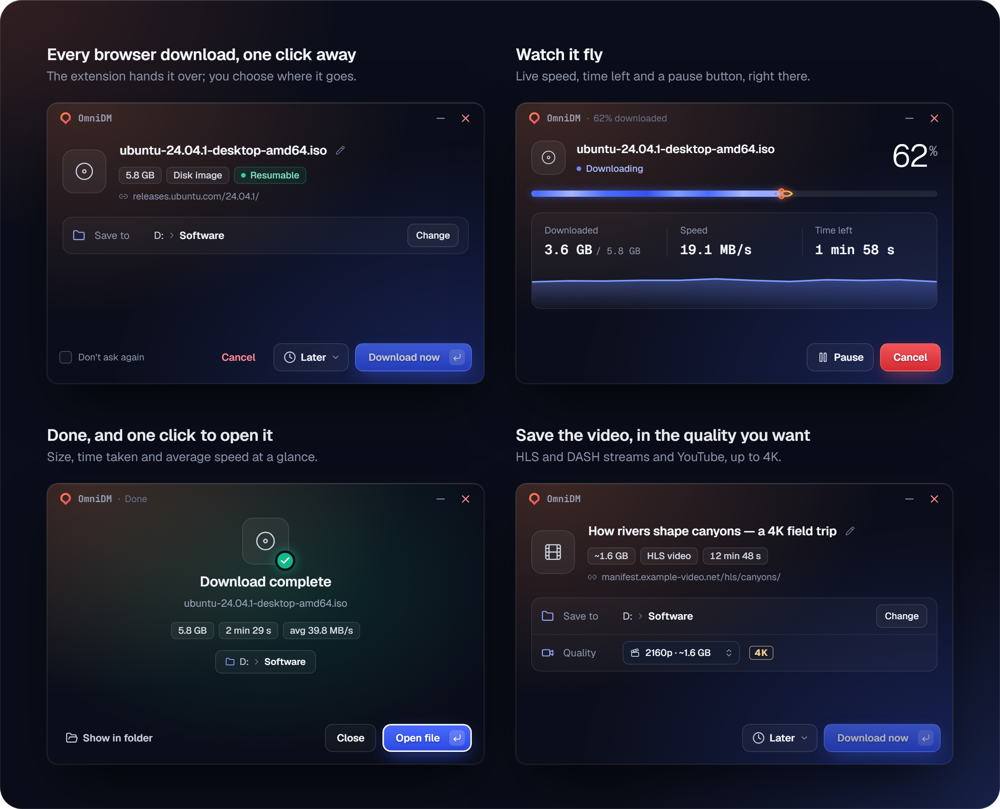
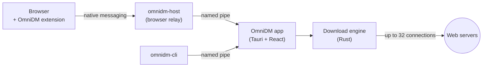

<div align="center">

<a href="https://github.com/FahimAnsawry/OmniDm/releases/latest">
  
</a>

<br>
<br>

[](https://github.com/FahimAnsawry/OmniDm/releases/latest)
[](https://github.com/FahimAnsawry/OmniDm/releases)
[](https://github.com/FahimAnsawry/OmniDm/actions/workflows/ci.yml)
[](LICENSE)
[](#quick-start)

<br>

<a href="https://github.com/FahimAnsawry/OmniDm/releases/latest">
  
</a>

<br>
<br>

**[Features](#features)** &nbsp;·&nbsp;
**[Quick start](#quick-start)** &nbsp;·&nbsp;
**[Command line](#command-line)** &nbsp;·&nbsp;
**[How it works](#how-it-works)** &nbsp;·&nbsp;
**[Build from source](#build-from-source)** &nbsp;·&nbsp;
**[Roadmap](#roadmap)**

</div>

<br>

OmniDM splits every download into many parallel connections, survives crashes and restarts without losing a byte, and takes over your browser's downloads with one click. It's written in **Rust**, runs as a normal user with **no admin rights**, sends **no telemetry**, and is **free software** under the GPL.

<br>

## Features

<table>
  <tr>
    <td width="33%" valign="top">
      
      <h3>Seriously fast</h3>
      Up to <b>32 connections</b> per file. Connections ramp up gradually and split the remaining work as they free up, so slow mirrors never hold you back.
    </td>
    <td width="33%" valign="top">
      
      <h3>Never lose a download</h3>
      Pause and resume any time, even after a crash, power cut or restart. A half-finished file is never passed off as complete.
    </td>
    <td width="33%" valign="top">
      
      <h3>Queues &amp; schedules</h3>
      Run downloads a few at a time, start them at night, <b>wake the PC</b> to begin, then sleep or shut down when they finish.
    </td>
  </tr>
  <tr>
    <td width="33%" valign="top">
      
      <h3>Browser integration</h3>
      An extension for <b>Chrome, Edge, Brave, Opera, Vivaldi and Firefox</b>. If OmniDM can't take a download, the browser keeps it.
    </td>
    <td width="33%" valign="top">
      
      <h3>Video, up to 4K</h3>
      Saves <b>HLS</b> and <b>DASH</b> streams and <b>YouTube</b> videos, with a quality picker and a Download button right on the video.
    </td>
    <td width="33%" valign="top">
      
      <h3>Private by design</h3>
      No telemetry, no local web server, no admin rights. Updates install themselves, and running downloads carry on afterwards.
    </td>
  </tr>
</table>

<details>
<summary><b>Everything else it does</b></summary>
<br>

- Cookies, custom headers, form posts and site logins (Basic and Digest)
- Follows the Windows proxy setting, including PAC scripts and auto-detect
- Retries stalled connections and respects servers that ask you to wait (`429`, `503`, `Retry-After`)
- Categories that sort downloads into their own folders
- Tray icon, notifications, and an "ask before downloading" prompt you can switch off
- A full command line, `omnidm-cli`, for terminals and scripts

</details>

<br>

<div align="center">
  
</div>

<br>

## Quick start

> [!TIP]
> No administrator rights are needed, and it takes about five minutes.

**1. Install the app.** Download **`OmniDM-<version>.zip`** from the [latest release](https://github.com/FahimAnsawry/OmniDm/releases/latest), unzip it, and run **`OmniDM-Setup-<version>.exe`**.

**2. Add the browser extension** from the `Extension` folder:

| Browser | Steps |
|---|---|
| **Chrome, Edge, Brave** | Move `OmniDM_chrome` somewhere it can stay → open `chrome://extensions` (or `edge://`, `brave://`) → turn on **Developer mode** → **Load unpacked** → pick the folder |
| **Firefox** | Open `about:debugging#/runtime/this-firefox` → **Load Temporary Add-on…** → choose `OmniDM_firefox\manifest.json` |

**3. Download something.** Click any download link and OmniDM takes it from there.

The zip also includes **How to install.html**, a step-by-step guide with pictures and troubleshooting.

<details>
<summary><b>Windows says "Windows protected your PC"</b></summary>
<br>

Click **More info**, then **Run anyway**. Windows shows this for new apps that aren't signed with a paid certificate yet.

</details>

<details>
<summary><b>Internet Download Manager is installed too</b></summary>
<br>

Turn off IDM's browser extension (or its "advanced browser integration"), so only one program takes your downloads.

</details>

<details>
<summary><b>Firefox removes the extension when it closes</b></summary>
<br>

Firefox only keeps add-ons that Mozilla has signed. Until OmniDM's is, load it again with the steps above after restarting Firefox. Chrome, Edge and Brave don't have this limit.

</details>

<details>
<summary><b>Updating</b></summary>
<br>

The app offers new versions by itself; downloads pause and carry on after the restart. The extension doesn't update itself yet: download `OmniDM-Extension-Chrome-<version>.zip` (or the Firefox one) from the latest release, replace the contents of your extension folder, and click the reload arrow on OmniDM's card in the extensions page.

</details>

<br>

## Command line

The installer puts `omnidm-cli` on your PATH, so it works in any new terminal.

```powershell
# Download a file. Ctrl+C pauses; run the same command again to resume.
omnidm-cli get https://example.com/big-file.zip --dir D:\Downloads

# Make a night queue: 3 at a time, starts at 01:30 on weekdays, wakes the PC, sleeps when done
omnidm-cli queue create Night --max 3 --then sleep
omnidm-cli queue schedule Night --at 01:30 --days weekdays --wake
omnidm-cli get https://example.com/big-file.zip --queue Night

# See what's there
omnidm-cli list
omnidm-cli queue list
```

Run `omnidm-cli --help` for every command and option.

<br>

## How it works



There is no local web server: the extension, the CLI and the app talk through a named pipe that only your Windows account can open. The engine treats everything it's handed as untrusted. It accepts only `http` and `https` links, cleans file names, keeps files inside your chosen folders, and never runs a downloaded file.

<br>

## Build from source

**You'll need** [Rust](https://rustup.rs) (stable), Visual Studio Build Tools with the *Desktop development with C++* workload, and Node.js 20 or newer. WebView2 already comes with Windows 10 and 11.

```sh
# Desktop app, with hot reload
cd app && npm install && npm run tauri dev

# Rust workspace (build the app UI first: the Tauri crate embeds app/dist)
cargo test --workspace

# Browser extension
cd extension && npm install
npm run build            # Chromium: Chrome, Edge, Brave, Opera, Vivaldi
npm run build:firefox    # Firefox
```

The full release package (setup, installer, extension zips and update manifest) comes from `.\scripts\build-setup.ps1`.

<details>
<summary><b>Repository layout</b></summary>
<br>

| Path | What's inside |
|---|---|
| `crates/omnidm-core` | Download engine: probing, segments, splitting, resume |
| `crates/omnidm-net` | HTTP client, redirects, sign-in, cookies, proxy |
| `crates/omnidm-store` | SQLite storage for downloads and settings |
| `crates/omnidm-queue` | Queues, scheduler and categories |
| `crates/omnidm-media` | HLS and DASH reading and decryption |
| `crates/omnidm-service` | The app's backend: runs downloads (including yt-dlp) and answers the extension and CLI |
| `crates/omnidm-ipc` | Named-pipe protocol between the app, CLI and browser relay |
| `crates/omnidm-host` | Native messaging host that connects the browser extension |
| `crates/omnidm-cli` | The `omnidm-cli` command line |
| `crates/omnidm-testserver` | Test server with fault switches for engine tests |
| `app/` | Desktop app: Tauri 2 (`src-tauri/`) with a React + TypeScript + Tailwind CSS UI |
| `extension/` | Browser extension built with WXT, React and Tailwind CSS |
| `installer/` | The setup window that wraps the NSIS installer |
| `protocol/` | Messages shared between the extension and the app |
| `docs/` | Build plan, install guide and release notes |

The full design lives in [`docs/omnidm-plan.md`](docs/omnidm-plan.md).

</details>

<br>

## Roadmap

- [x] Multi-connection engine with safe resume
- [x] Browser extension for Chromium browsers and Firefox
- [x] Queues, scheduler and categories
- [x] HLS, DASH and YouTube video
- [x] Auto-update
- [ ] Extensions in the Chrome Web Store, Edge Add-ons and Firefox Add-ons
- [ ] Joining video and audio into one file (FFmpeg)
- [ ] FTP / FTPS, NTLM sign-in and HTTP/3
- [ ] macOS and Linux

<br>

## Contributing

Bug reports, ideas and pull requests are welcome. Read [CONTRIBUTING.md](CONTRIBUTING.md) first: it covers the ground rules (original work only, GPL-3.0 licence headers, tests for engine changes) and the checks to run before opening a pull request.

Found a security problem? Please don't post the details in a public issue. Open an issue asking for a private contact instead.

## Licence

OmniDM is free software under the [GNU General Public License v3.0 or later](LICENSE). You can use, study, share and change it, and every version shared stays free too.

<br>

<div align="center">
  
  <br>
  <sub>Built with Rust, Tauri, React and TypeScript.</sub>
</div>
